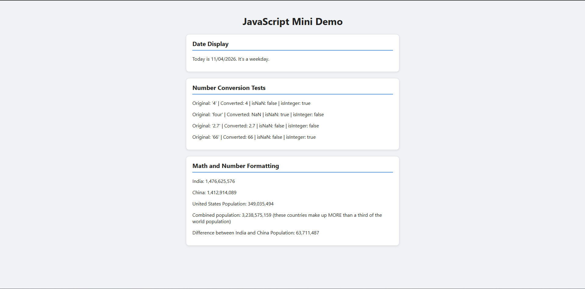

# JavaScript Mini Demo

## Live Site

https://amin-zoghlami.github.io/comp484-hw9/

## Screenshot

Path: `screenshot.png`

## Built-in Objects and Methods

- `Date`: `getMonth()`, `getDate()`, `getFullYear()`, `getDay()`
- `Number`: `Number()`, `Number.isNaN()`, `Number.isInteger()`, `Number.prototype.toLocaleString()`
- `String`: `String()`, `padStart()`

## Extra Credit

Added light CSS styling so each section looks like a card.

## Reflection

The easiest part was displaying the date in Part 1 as the Date object gave the month, day, and year directly. The hardest part was writing Part 2 without loops and putting all the results together into HTML. For the Date object, I learned that getMonth() is zero-based, which surprised me. With the Number object, I learned that Number() returns NaN for strings that aren't numbers. As for displaying results in the browser, I realized there are many ways to select an element and change its content.
